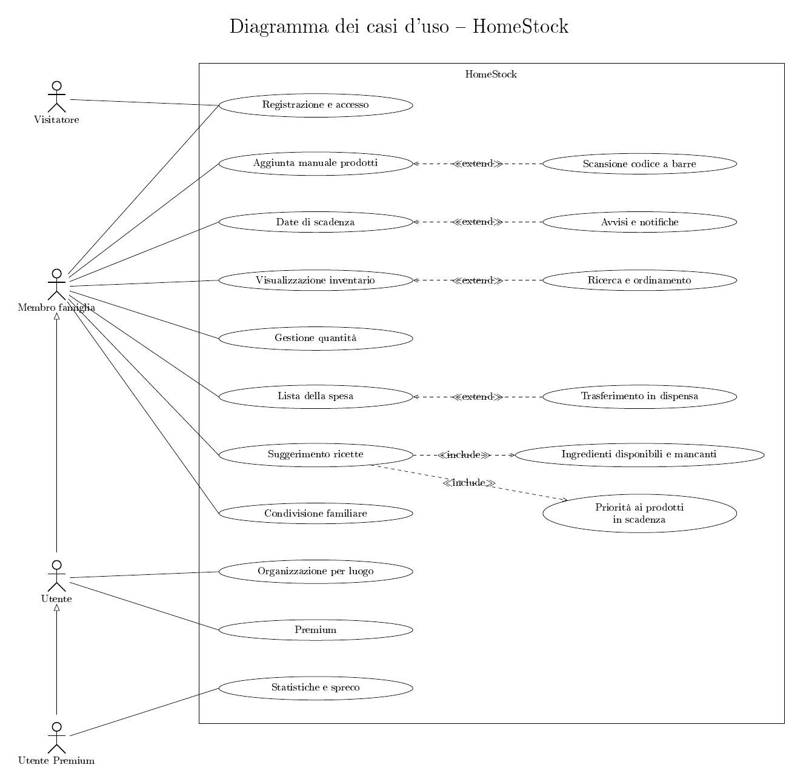
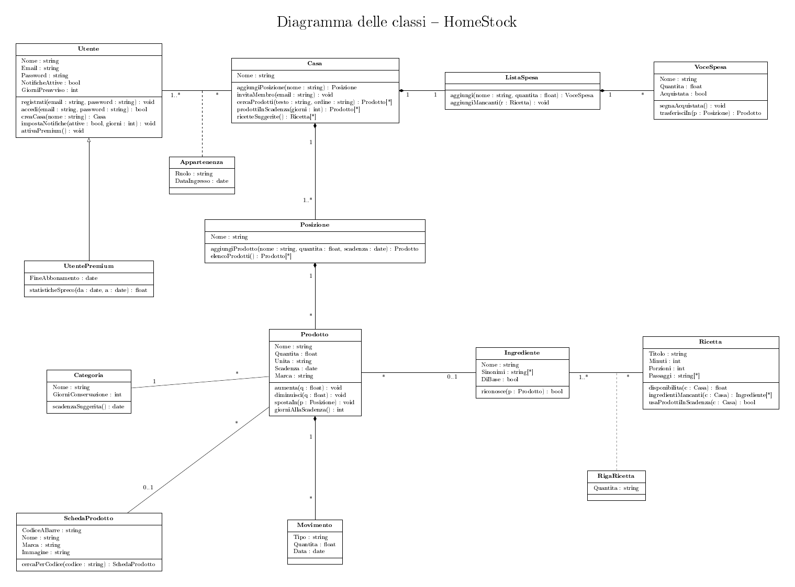

# HomeStock

> **La cena è già in casa.**

Progetto annuale di **Gestione Progetto** — classe quinta, ITIS "P. Paleocapa" di Bergamo.
Autore: Tommaso Cremaschi.

---

## Indice

1. [Descrizione](#1-descrizione)
2. [Problema da risolvere](#2-problema-da-risolvere)
3. [Target](#3-target)
4. [Competitor](#4-competitor)
5. [Funzionalità](#5-funzionalità)
6. [Attori](#6-attori)
7. [Funzionalità e attori](#7-funzionalità-e-attori)
8. [Ordinamento delle funzionalità](#8-ordinamento-delle-funzionalità)
9. [Diagramma dei casi d'uso](#9-diagramma-dei-casi-duso)
10. [Diagramma delle classi](#10-diagramma-delle-classi)
11. [Coerenza tra i due diagrammi](#11-coerenza-tra-i-due-diagrammi)
12. [Schermate e navigazione](#12-schermate-e-navigazione)
13. [Linee guida grafiche](#13-linee-guida-grafiche)
14. [Tecnologie](#14-tecnologie)
15. [Versione gratuita e Premium](#15-versione-gratuita-e-premium)
16. [Roadmap](#16-roadmap)
17. [Rischi tecnici](#17-rischi-tecnici)
18. [Costi](#18-costi)
19. [Struttura della repository](#19-struttura-della-repository)
20. [Fonti](#20-fonti)

---

## 1. Descrizione

HomeStock tiene traccia di quello che hai davvero in casa — frigorifero, freezer, dispensa — e lo trasforma in una risposta concreta: **cosa cucinare stasera e cosa comprare domani**. I prodotti si aggiungono scansionando il codice a barre, l'app calcola le scadenze e propone ricette costruite su ciò che sta per scadere.

Il progetto è pensato per essere realizzato indifferentemente come **applicazione mobile** (Android e iOS) o come **web application** accessibile da browser, condividendo lo stesso backend e la stessa struttura dati.

L'app collega in modo naturale quattro domande, che sono il cuore dell'intera esperienza:

```
COSA HO  →  COSA STA SCADENDO  →  COSA POSSO CUCINARE  →  COSA DEVO COMPRARE
```

**Principio fondamentale: semplicità.** L'utente non deve compilare quindici campi ogni volta che compra qualcosa. Il flusso ideale è:

```
Compro il latte → scansiono → l'app riconosce il prodotto → confermo quantità,
posizione e scadenza → fatto. Pochi secondi.
```

**Cosa HomeStock non vuole essere:** un'app complicata, con schermate sovraccariche, un'interfaccia da gestionale aziendale, dipendente dall'intelligenza artificiale per funzionare o con costi server inutilmente elevati.

---

## 2. Problema da risolvere

Tre problemi collegati, in ordine di peso.

**Lo spreco alimentare domestico.** Nell'autunno 2026 ogni italiano getta in media **493,7 grammi di cibo a settimana**. Il dato è in calo, ma il costo complessivo dello spreco alimentare in Italia supera i **13,5 miliardi di euro**, di cui oltre **7,3 miliardi prodotti dentro le case**. In cima alla classifica dei cibi buttati ci sono i prodotti freschi e deperibili: proprio quelli con una scadenza che un'app può sorvegliare.

**Il doppio acquisto.** Si ricompra ciò che si ha già, perché nessuno ricorda il contenuto della dispensa mentre è al supermercato.

**La decisione quotidiana.** «Cosa cucino stasera?» viene deciso davanti al frigo aperto, senza sapere cosa sta per scadere.

In sintesi, HomeStock risolve cinque situazioni comuni:

1. dimenticarsi cosa si ha già in casa;
2. comprare prodotti che si possiedono già;
3. dimenticarsi della scadenza degli alimenti;
4. non sapere cosa cucinare;
5. dimenticare di comprare i prodotti finiti.

---

## 3. Target

**Primario: 25–40 anni, coppie e famiglie giovani** che fanno una spesa settimanale grande. Le famiglie della Generazione Z sprecano in media **799 g** di cibo a settimana a persona e i Millennials **750 g**, contro i **352 g** degli over 60: chi ha il problema più grande è anche chi usa già le app.

**Secondario: studenti fuori sede e coinquilini**, dove la dispensa è condivisa e nessuno sa di chi è cosa.

**Fuori target: over 65.** Sprecano meno e sono i più difficili da portare su un'app nuova.

L'app deve comunque essere usabile da una persona poco esperta di tecnologia.

---

## 4. Competitor

| App | Punti di forza | Cosa le manca |
|---|---|---|
| **Bring!** | Lista della spesa condivisa, molto diffusa in Italia e curata | Nessun inventario, nessuna scadenza |
| **Spesa e Dispensa** (italiana) | Dispensa, liste, avvisi di scadenza, sito collegato | Poca diffusione, nessun legame con le ricette |
| **PantrySmart** | La più vicina all'idea: inventario, scadenze, scansione con Open Food Facts, ricette | In inglese, interfaccia densa da utente esperto |
| **NoWaste, Pantry Check, KitchenPal** | Inventario e scadenze fatti bene | Ricette assenti o marginali |
| **Samsung Food** | Ricette e pianificazione dei pasti | Inventario debole, legata all'ecosistema Samsung |

**Lo spazio libero.** Nessuna di queste nasce dall'italiano: ricette italiane vere, prodotti dei supermercati italiani, reparti come quelli dei nostri negozi. E nessuna si apre con una risposta («stasera puoi fare questo») invece che con un inventario da compilare.

---

## 5. Funzionalità

| N. | Funzionalità | Descrizione | Versione |
|---:|---|---|:---:|
| 1 | Registrazione e accesso | Creazione dell'account con email e password, Google o Apple. I dati restano dell'utente anche se cambia telefono. | V1 |
| 2 | Organizzazione per luogo | I prodotti sono divisi per dove si trovano: Frigorifero, Freezer, Dispensa già pronti, più posizioni personalizzate (Cantina, Frigo piccolo…). | V1 |
| 3 | Aggiunta manuale prodotti | Inserimento di nome, quantità, unità, posizione, scadenza, categoria; marca e note facoltative. Serve per frutta sfusa, pane e tutto ciò che non ha codice a barre. | V1 |
| 4 | Scansione codice a barre | Si inquadra il codice EAN e l'app cerca il prodotto su Open Food Facts, compilando i dati da sola. L'utente conferma o corregge. Se il prodotto non c'è si inserisce a mano e resta collegato al codice. | V1 |
| 5 | Visualizzazione inventario | Tutto quello che c'è in casa, diviso per posizione, con quantità e giorni alla scadenza. | V1 |
| 6 | Gestione quantità | Con un tocco si aumenta o diminuisce la quantità. A zero l'app avvisa che il prodotto è finito e propone di metterlo nella lista della spesa. | V1 |
| 7 | Ricerca e ordinamento | Ricerca per nome, anche dentro una singola posizione; ordinamento per scadenza o alfabetico; filtro per categoria. | V1 |
| 8 | Date di scadenza | Calcolo automatico dei giorni rimanenti; stati visivi scaduto / scade oggi / entro 3 giorni / in regola; scadenza suggerita in base alla categoria. | V1 |
| 9 | Avvisi e notifiche | Notifica locale per i prodotti in scadenza, attivabile e disattivabile, con i giorni di anticipo configurabili. | V1 |
| 10 | Lista della spesa | Lista modificabile a mano, che si riempie anche da sola con i prodotti finiti e con gli ingredienti mancanti delle ricette. | V1 |
| 11 | Trasferimento in dispensa | Quando si spunta un prodotto acquistato, l'app chiede in quale posizione metterlo e lo aggiunge alla casa. | V1 |
| 12 | Suggerimento ricette | Confronto tra quello che c'è in casa e un archivio di ricette italiane. Nessuna intelligenza artificiale: è un confronto sui dati. | V1 |
| 13 | Ingredienti disponibili e mancanti | Per ogni ricetta: cosa hai già, cosa manca (es. «hai 4 su 5»), con il pulsante per aggiungere i mancanti alla spesa. | V1 |
| 14 | Priorità ai prodotti in scadenza | Le ricette proposte per prime sono quelle che usano ciò che sta per scadere. | V1 |
| 15 | Condivisione familiare | Più persone della stessa famiglia vedono e modificano la stessa casa in tempo reale. | Futuro |
| 16 | Statistiche e spreco | Riepiloghi su consumi e prodotti buttati, per capire dove si perdono soldi. | Futuro |
| 17 | Premium | Abbonamento che sblocca le funzioni avanzate. | Futuro |

**Categorie di prodotto iniziali:** Pasta e riso, Pane e prodotti da forno, Carne, Pesce, Frutta, Verdura, Latticini, Uova, Surgelati, Bevande, Snack, Dolci, Condimenti, Conserve, Colazione, Altro.

---

## 6. Attori

| Attore | Chi è |
|---|---|
| **Visitatore** | Ha installato l'app o aperto il sito ma non ha ancora un account. Può solo registrarsi o accedere. |
| **Membro famiglia** | Utente registrato che **usa** una casa: aggiunge prodotti, li consuma, gestisce la lista della spesa, guarda le ricette. Se è stato invitato nella casa di un altro, non ne modifica la struttura. |
| **Utente** | Il **proprietario** della casa: l'ha creata lui. Fa tutto quello che fa un Membro famiglia e in più decide la struttura (posizioni) e può attivare il Premium. |
| **Utente Premium** | Un Utente con l'abbonamento attivo. Fa tutto quello che fa un Utente e in più accede alle statistiche. |

**Generalizzazione tra attori.** Nel diagramma dei casi d'uso le frecce con il triangolo vuoto indicano che *Utente* eredita tutti i casi d'uso di *Membro famiglia*, e *Utente Premium* eredita tutti quelli di *Utente*. Così ogni caso d'uso è collegato una sola volta e il diagramma resta leggibile.

**Il sistema non è un attore.** Un attore è qualcuno *esterno* al sistema che lo usa. HomeStock stesso è rappresentato dal rettangolo che contiene i casi d'uso; le cose che l'app fa da sola (calcolare i giorni alla scadenza, cercare il codice a barre, ordinare le ricette) sono comportamenti interni, che nel diagramma delle classi diventano **metodi**.

**Utente e Membro famiglia sono ruoli, non tipi di persona.** Nel diagramma delle classi esiste una sola classe `Utente`; il ruolo (`proprietario` o `membro`) sta nella classe di associazione `Appartenenza`, perché dipende dalla casa: la stessa persona può essere proprietaria della propria casa e membro in quella dei genitori.

---

## 7. Funzionalità e attori

Nella colonna *Attori* ci sono gli attori collegati direttamente nel diagramma. Grazie alla generalizzazione, ciò che fa il Membro famiglia lo possono fare anche Utente e Utente Premium.

| N. | Funzionalità | Attori | Relazione nel diagramma |
|---:|---|---|---|
| 1 | Registrazione e accesso | Visitatore, Membro famiglia | — |
| 2 | Organizzazione per luogo | Utente | — |
| 3 | Aggiunta manuale prodotti | Membro famiglia | — |
| 4 | Scansione codice a barre | tramite il caso base | «extend» → Aggiunta manuale prodotti |
| 5 | Visualizzazione inventario | Membro famiglia | — |
| 6 | Gestione quantità | Membro famiglia | — |
| 7 | Ricerca e ordinamento | tramite il caso base | «extend» → Visualizzazione inventario |
| 8 | Date di scadenza | Membro famiglia | — |
| 9 | Avvisi e notifiche | tramite il caso base | «extend» → Date di scadenza |
| 10 | Lista della spesa | Membro famiglia | — |
| 11 | Trasferimento in dispensa | tramite il caso base | «extend» → Lista della spesa |
| 12 | Suggerimento ricette | Membro famiglia | «include» Ingredienti e Priorità |
| 13 | Ingredienti disponibili e mancanti | tramite il caso base | incluso da Suggerimento ricette |
| 14 | Priorità ai prodotti in scadenza | tramite il caso base | incluso da Suggerimento ricette |
| 15 | Condivisione familiare | Membro famiglia | — |
| 16 | Statistiche e spreco | Utente Premium | — |
| 17 | Premium | Utente | — |

**«extend»:** il caso d'uso è un'aggiunta *facoltativa* al caso base (la freccia parte dall'estensione e va verso il caso base). Esempio: posso aggiungere un prodotto anche senza scansionarlo.
**«include»:** il caso d'uso viene eseguito *sempre* come parte del caso base (la freccia parte dal caso base). Esempio: ogni volta che l'app suggerisce le ricette, calcola anche ingredienti mancanti e priorità.

---

## 8. Ordinamento delle funzionalità

La stessa lista ordinata secondo quattro criteri diversi (1 = prima posizione).

| N. | Funzionalità | Dipendenza tecnica | Valore per l'utente | Rischio | Frequenza d'uso |
|---:|---|:---:|:---:|:---:|:---:|
| 1 | Registrazione e accesso | 1 | 14 | 7 | 17 |
| 2 | Organizzazione per luogo | 2 | 12 | 14 | 14 |
| 3 | Aggiunta manuale prodotti | 4 | 2 | 15 | 11 |
| 4 | Scansione codice a barre | 7 | 6 | 1 | 10 |
| 5 | Visualizzazione inventario | 5 | 1 | 13 | 1 |
| 6 | Gestione quantità | 8 | 5 | 12 | 2 |
| 7 | Ricerca e ordinamento | 9 | 13 | 16 | 9 |
| 8 | Date di scadenza | 6 | 3 | 11 | 6 |
| 9 | Avvisi e notifiche | 11 | 8 | 6 | 5 |
| 10 | Lista della spesa | 3 | 4 | 17 | 3 |
| 11 | Trasferimento in dispensa | 10 | 9 | 9 | 12 |
| 12 | Suggerimento ricette | 12 | 7 | 2 | 4 |
| 13 | Ingredienti disponibili e mancanti | 13 | 11 | 3 | 8 |
| 14 | Priorità ai prodotti in scadenza | 14 | 10 | 8 | 7 |
| 15 | Condivisione familiare | 16 | 15 | 4 | 15 |
| 16 | Statistiche e spreco | 15 | 16 | 10 | 13 |
| 17 | Premium | 17 | 17 | 5 | 16 |

### 8.1 Dipendenza tecnica — l'ordine di sviluppo

Se B ha bisogno di A per funzionare, A viene prima. Non è negoziabile.

1. **Registrazione e accesso** — ogni dato deve appartenere a qualcuno; non dipende da niente.
2. **Organizzazione per luogo** — le posizioni appartengono a un utente, e un prodotto deve avere dove essere messo.
3. **Lista della spesa** — dipende solo dall'account: è l'unica funzione che non ha bisogno dell'inventario.
4. **Aggiunta manuale prodotti** — servono le posizioni in cui mettere il prodotto.
5. **Visualizzazione inventario** — senza prodotti inseriti non c'è niente da mostrare.
6. **Date di scadenza** — la data è un campo del prodotto e si mostra nell'elenco.
7. **Scansione codice a barre** — compila lo stesso modulo dell'inserimento manuale; se il prodotto non viene trovato ricade proprio lì.
8. **Gestione quantità** — si modifica dall'elenco dei prodotti.
9. **Ricerca e ordinamento** — ha senso solo quando i prodotti sono tanti.
10. **Trasferimento in dispensa** — è il ponte tra lista della spesa e inventario: devono esistere entrambi.
11. **Avvisi e notifiche** — una notifica è una scadenza già calcolata, mandata al telefono.
12. **Suggerimento ricette** — per dire cosa puoi cucinare l'app deve sapere cosa hai in casa.
13. **Ingredienti disponibili e mancanti** — è il dettaglio di una ricetta già proposta.
14. **Priorità ai prodotti in scadenza** — incrocia ricette e scadenze: servono entrambe.
15. **Statistiche e spreco** — si calcolano sui consumi registrati nel tempo.
16. **Condivisione familiare** — tocca ogni dato e ogni schermata, va fatta per ultima (ma il modello dati la prevede da subito).
17. **Premium** — l'abbonamento ha senso quando c'è qualcosa da vendere, cioè la condivisione.

### 8.2 Valore per l'utente

A parità di dipendenze, prima ciò che rende l'app già utile da sola. In alto l'inventario e le scadenze (il beneficio concreto: smettere di buttare cibo), in mezzo le funzioni che moltiplicano il valore (scansione, ricette, notifiche), in basso la struttura. **Registrazione e accesso** è prima per dipendenza ma quattordicesima per valore: all'utente non dà niente, anzi è un ostacolo prima di aver capito se l'app gli serve.

### 8.3 Rischio

Quanto è incerto che una funzione riesca come previsto. Le funzioni in alto non si sviluppano per prime, ma si **provano** per prime con un prototipo rapido:

- **Scansione:** dipende da un database esterno; se i prodotti italiani non vengono riconosciuti, la promessa dell'app cade. Prova prevista: scansionare 20 prodotti veri di una dispensa e misurare quanti vengono riconosciuti.
- **Ricette e ingredienti:** non esiste una fonte pronta di ricette italiane con ingredienti strutturati, e collegare «Barilla Penne Rigate n.73» all'ingrediente «pasta» è un problema di normalizzazione.
- **Condivisione e Premium:** sicurezza dei dati, modifiche simultanee, regole degli store sui pagamenti.

### 8.4 Frequenza d'uso

- **Ogni giorno:** inventario, gestione quantità, lista della spesa, ricette, notifiche. Vanno ottimizzate al singolo tocco: se per scalare il latte servono tre schermate, l'utente smette di aggiornare l'app e i dati diventano falsi.
- **Ogni settimana, in blocco:** scansione, inserimento e trasferimento, tutti al rientro dal supermercato. Devono reggere la ripetizione (dieci prodotti di fila senza uscire dalla fotocamera).
- **Raramente o una volta sola:** posizioni, statistiche, registrazione.

---

## 9. Diagramma dei casi d'uso



Sorgente LaTeX: [`diagrammi/DiagrammaCasiUso.tex`](diagrammi/DiagrammaCasiUso.tex) — PDF: [`diagrammi/DiagrammaCasiUso.pdf`](diagrammi/DiagrammaCasiUso.pdf)

---

## 10. Diagramma delle classi



Sorgente LaTeX: [`diagrammi/DiagrammaClassi.tex`](diagrammi/DiagrammaClassi.tex) — PDF: [`diagrammi/DiagrammaClassi.pdf`](diagrammi/DiagrammaClassi.pdf)

### Le classi

| Classe | Cosa rappresenta |
|---|---|
| `Utente` | Una persona registrata, con le sue impostazioni di notifica |
| `UtentePremium` | Un utente con abbonamento attivo (eredita da `Utente`) |
| `Casa` | La casa digitale: contiene posizioni e lista della spesa |
| `Appartenenza` | Classe di associazione tra `Utente` e `Casa`: dice con quale **ruolo** (proprietario o membro) una persona fa parte di una casa |
| `Posizione` | Frigorifero, Freezer, Dispensa o una posizione personalizzata |
| `Prodotto` | Una confezione reale in casa, con la *sua* quantità e la *sua* scadenza |
| `Categoria` | Tipo di prodotto, con i giorni di conservazione usati per suggerire la scadenza |
| `SchedaProdotto` | I dati legati al codice a barre (nome, marca, immagine), uguali per tutti gli utenti |
| `Movimento` | Ogni variazione di quantità (aggiunto, consumato, buttato): è la base delle statistiche |
| `ListaSpesa` / `VoceSpesa` | La lista della spesa della casa e le sue righe |
| `Ingrediente` | Ingrediente "canonico" (es. *pasta*) con i suoi sinonimi (*spaghetti*, *penne*…) |
| `Ricetta` | Una ricetta dell'archivio |
| `RigaRicetta` | Classe di associazione tra `Ricetta` e `Ingrediente`: la quantità di quell'ingrediente in quella ricetta |

### Scelte di progetto

- **Composizione** (rombo pieno) dove la parte non esiste senza il tutto: `Casa` → `Posizione` → `Prodotto` → `Movimento`, `Casa` → `ListaSpesa` → `VoceSpesa`. Se si elimina la casa, sparisce tutto quello che contiene.
- **`Prodotto` e `SchedaProdotto` sono separati:** la scheda del codice a barre si scarica una volta e serve a tutti; quantità e scadenza sono della singola confezione.
- **`Prodotto` → `Ingrediente`** è il collegamento che permette il confronto con le ricette (molteplicità 0..1: non tutto quello che si compra è un ingrediente).
- **`Visitatore` non è una classe:** non è registrato, quindi non ha dati da salvare.

---

## 11. Coerenza tra i due diagrammi

Ogni attore e ogni caso d'uso ha la sua corrispondenza nel diagramma delle classi.

| Attore | Nel diagramma delle classi |
|---|---|
| Visitatore | Nessuna classe: diventa un oggetto `Utente` con `registrati()` |
| Membro famiglia | `Utente` collegato alla `Casa` con `Appartenenza.Ruolo = membro` |
| Utente | `Utente` collegato alla `Casa` con `Appartenenza.Ruolo = proprietario` |
| Utente Premium | `UtentePremium` (eredita da `Utente`) |

| N. | Caso d'uso | Classi e metodi |
|---:|---|---|
| 1 | Registrazione e accesso | `Utente.registrati()`, `Utente.accedi()`, `Utente.creaCasa()` |
| 2 | Organizzazione per luogo | `Posizione`, `Casa.aggiungiPosizione()` |
| 3 | Aggiunta manuale prodotti | `Prodotto`, `Posizione.aggiungiProdotto()`, `Categoria.scadenzaSuggerita()` |
| 4 | Scansione codice a barre | `SchedaProdotto.cercaPerCodice()` |
| 5 | Visualizzazione inventario | `Posizione.elencoProdotti()` |
| 6 | Gestione quantità | `Prodotto.aumenta()`, `Prodotto.diminuisci()`, `Prodotto.spostaIn()`, `Movimento` |
| 7 | Ricerca e ordinamento | `Casa.cercaProdotti()` |
| 8 | Date di scadenza | `Prodotto.Scadenza`, `Prodotto.giorniAllaScadenza()` |
| 9 | Avvisi e notifiche | `Utente.impostaNotifiche()`, `Casa.prodottiInScadenza()` |
| 10 | Lista della spesa | `ListaSpesa.aggiungi()`, `VoceSpesa` |
| 11 | Trasferimento in dispensa | `VoceSpesa.segnaAcquistata()`, `VoceSpesa.trasferisciIn()` |
| 12 | Suggerimento ricette | `Casa.ricetteSuggerite()`, `Ricetta.disponibilita()` |
| 13 | Ingredienti disponibili e mancanti | `Ricetta.ingredientiMancanti()`, `Ingrediente.riconosce()`, `ListaSpesa.aggiungiMancanti()` |
| 14 | Priorità ai prodotti in scadenza | `Ricetta.usaProdottiInScadenza()` |
| 15 | Condivisione familiare | `Appartenenza`, `Casa.invitaMembro()` |
| 16 | Statistiche e spreco | `UtentePremium.statisticheSpreco()`, `Movimento` |
| 17 | Premium | `Utente.attivaPremium()`, `UtentePremium` |

---

## 12. Schermate e navigazione

Navigazione principale con una barra in basso a cinque voci; la scansione è al centro ed è il pulsante più evidente.

| Schermata | Contenuto |
|---|---|
| **Oggi** (Home) | La ricetta suggerita per stasera, costruita su ciò che scade; i prodotti da usare subito; il riepilogo per posizione (es. Frigorifero 16, Dispensa 24, Freezer 7); pulsanti rapidi Aggiungi e Spesa |
| **Casa** | Inventario per posizione, ricerca, filtri, ordinamento, + e − sulle quantità |
| **Scansiona** | Fotocamera per il codice a barre, conferma dei dati, modalità a raffica |
| **Spesa** | Lista della spesa con spunta e trasferimento in dispensa |
| **Ricette** | Ricette ordinate per disponibilità, con «hai già» e «ti manca» |

Alla prima apertura: schermata di presentazione («La tua casa, sempre sotto controllo») con i pulsanti *Crea account* e *Accedi*.

---

## 13. Linee guida grafiche

- **Il colore significa tempo:** è colorato solo ciò che sta per scadere (ambra a giorni, rosso oggi o scaduto). Tutto il resto è neutro, così l'occhio va dove serve.
- **Colore del marchio** (verde acqua) solo per logo e azioni principali.
- **Titoli con un carattere serif**, testi con un sans-serif: distingue HomeStock dalle app concorrenti, che usano tutte lo stesso stile arrotondato.
- **Niente emoji nell'interfaccia:** un solo set di icone.
- **Card con il filo di un ripiano** sotto le posizioni: l'unico elemento decorativo, preso dal soggetto.
- Interfaccia moderna, pulita e semplice; animazioni leggere solo quando rispondono a un'azione.

---

## 14. Tecnologie

| Ambito | Scelta | Motivo |
|---|---|---|
| App | **React Native con Expo** (expo-router) | Una sola base di codice per Android, iOS e web |
| Backend | **Supabase** (PostgreSQL, autenticazione, Row Level Security, realtime) | Gratuito fino a migliaia di utenti; la sicurezza per riga protegge i dati di ogni casa |
| Scansione | expo-camera, codici EAN-13 / EAN-8 | Codici a barre commerciali, non QR code |
| Dati prodotto | **API Open Food Facts** con cache locale | Gratuita, senza chiave, licenza ODbL (uso commerciale permesso con attribuzione) |
| Notifiche | expo-notifications, notifiche **locali** | Nessun server, nessun costo, funzionano offline |
| Ricette | Database interno con ingredienti canonici | Non esiste una fonte gratuita di ricette italiane strutturate |
| Build e pubblicazione | EAS Build, Google Play Console, App Store Connect | Build in cloud senza Xcode o Android Studio |

**Web o app:** la versione web (PWA) è la strada per il prototipo e i test rapidi; quella nativa è la versione finale. Nel browser la scansione funziona ma è meno affidabile (soprattutto su Safari iOS) e le notifiche su iOS richiedono di aggiungere il sito alla schermata Home.

**Nessuna intelligenza artificiale a pagamento:** il confronto tra dispensa e ricette è una query sui dati.

---

## 15. Versione gratuita e Premium

| Gratuita | Premium (futuro) |
|---|---|
| Gestione della casa e dei prodotti | Condivisione familiare in tempo reale |
| Scansione | Statistiche su consumi e spreco |
| Scadenze e notifiche | Cronologia completa |
| Lista della spesa | Più case |
| Ricette base | Prodotti illimitati, filtri e ricette avanzate |

Il sistema di pagamento non fa parte della prima versione, ma il modello dati è già pronto (classe `UtentePremium`).

---

## 16. Roadmap

| Fase | Contenuto | Durata stimata |
|---|---|---|
| 0 | Validazione dell'idea, analisi concorrenti, scelta stack, apertura account Google Play | 2–3 giorni |
| 1 | Setup tecnico: progetto Expo, Supabase, navigazione, stile base | 2–3 giorni |
| 2 | Account, database, sicurezza (RLS), strategia offline | 3–5 giorni |
| 3 | Dispensa: posizioni, inserimento manuale, quantità, scadenze, Home | 1–2 settimane |
| 4 | Scanner con Open Food Facts e modalità a raffica | 4–6 giorni |
| 5 | Lista della spesa e trasferimento in dispensa | 3–4 giorni |
| 6 | Ricette: ingredienti canonici, 60–80 ricette, confronto con la dispensa | 1–2 settimane |
| 7 | Notifiche locali | 2–3 giorni |
| 8 | Rifinitura, onboarding, privacy (GDPR), test con utenti | 1 settimana |
| 9 | Pubblicazione: test chiuso Google Play (12 tester per 14 giorni), revisione Apple | 3–4 settimane |
| 10 | Dopo il lancio: misura della retention, poi progettazione del Premium | continuo |

**Stato attuale:** analisi completata (funzionalità, attori, ordinamenti, diagramma dei casi d'uso, diagramma delle classi) e primo prototipo web in un singolo file HTML con inventario, scadenze, scansione, lista della spesa e ricette.

---

## 17. Rischi tecnici

| Rischio | Mitigazione |
|---|---|
| L'utente smette di aggiornare le quantità dopo due settimane | Consumo con un tocco dalla Home, scansione a raffica, notifiche al momento giusto |
| Il codice a barre **non contiene la data di scadenza** | Scadenza suggerita per categoria, da confermare o correggere |
| Prodotti italiani non riconosciuti da Open Food Facts | Prova anticipata su prodotti reali; inserimento manuale collegato al codice per le volte successive |
| Collegamento prodotto → ingrediente delle ricette | Tabella di ingredienti canonici con sinonimi e correzione manuale |
| Dati di tutti gli utenti esposti | Row Level Security su ogni tabella, basata sull'appartenenza alla casa |
| Uso al supermercato senza rete | Lettura da cache locale e coda di scritture da sincronizzare |

---

## 18. Costi

| Voce | Costo |
|---|---|
| Google Play Console | 25 $ una tantum |
| Apple Developer Program | circa 99 € l'anno (solo per iOS) |
| Supabase | 0 € con il piano gratuito |
| Open Food Facts | 0 € |
| Expo EAS | 0 € con le build in coda |

---

## 19. Struttura della repository

```
progettoGPO/
├── README.md                     questo documento
├── diagrammi/
│   ├── DiagrammaCasiUso.tex      sorgente LaTeX (tikz-uml)
│   ├── DiagrammaCasiUso.pdf
│   ├── DiagrammaCasiUso.png
│   ├── DiagrammaClassi.tex       sorgente LaTeX (tikz-uml)
│   ├── DiagrammaClassi.pdf
│   ├── DiagrammaClassi.png
│   └── tikz-uml.sty              pacchetto necessario per compilare i diagrammi
└── DRAFT/                        materiale di lavoro
```

**Compilare i diagrammi:** su Overleaf carica il file `.tex` insieme a `tikz-uml.sty` e compila con pdfLaTeX.

---

## 20. Fonti

- [Spreco alimentare, scende sotto i 500 grammi a testa a settimana — Dalla Platea (Waste Watcher, autunno 2026)](https://www.dallaplatea.it/2026/09/24/spreco-alimentare-scende-sotto-i-500-grammi-a-testa-a-settimana/)
- [Rapporto Waste Watcher International 2026 — Confcommercio](https://www.confcommercio.it/-/fipe-osservatorio-waste-watcher)
- [Spreco alimentare, il buco nel frigorifero — QuiFinanza](https://quifinanza.it/lifestyle/food-economy/spreco-alimentare-cibo-conto-nascosto/1012939/)
- [Spreco alimentare in Italia, Boomers più virtuosi — Spazio50](https://www.spazio50.org/spreco-alimentare-in-italia-boomers-piu-virtuosi-i-dati-del-rapporto-waste-watcher-2026/)
- [Open Food Facts — documentazione API e licenza](https://openfoodfacts.github.io/openfoodfacts-server/api/)
- [Google Play — requisiti di test per i nuovi account sviluppatore](https://support.google.com/googleplay/android-developer/answer/14151465?hl=it)
